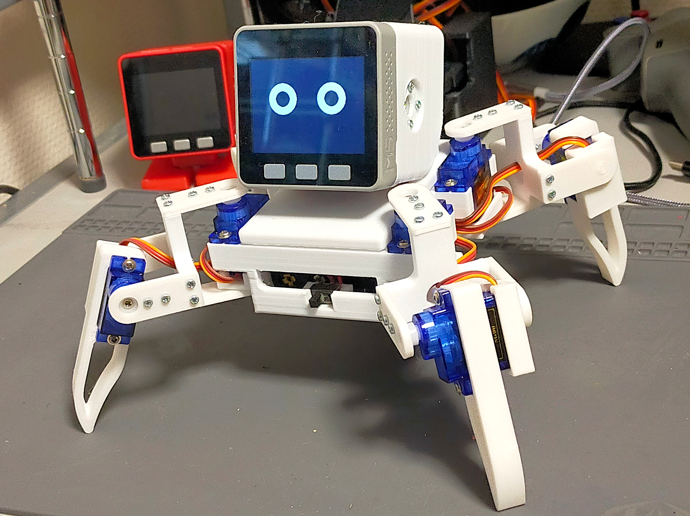
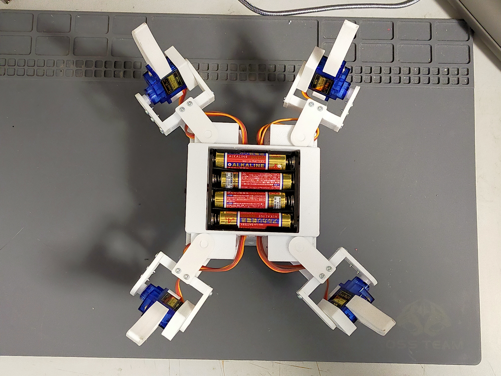
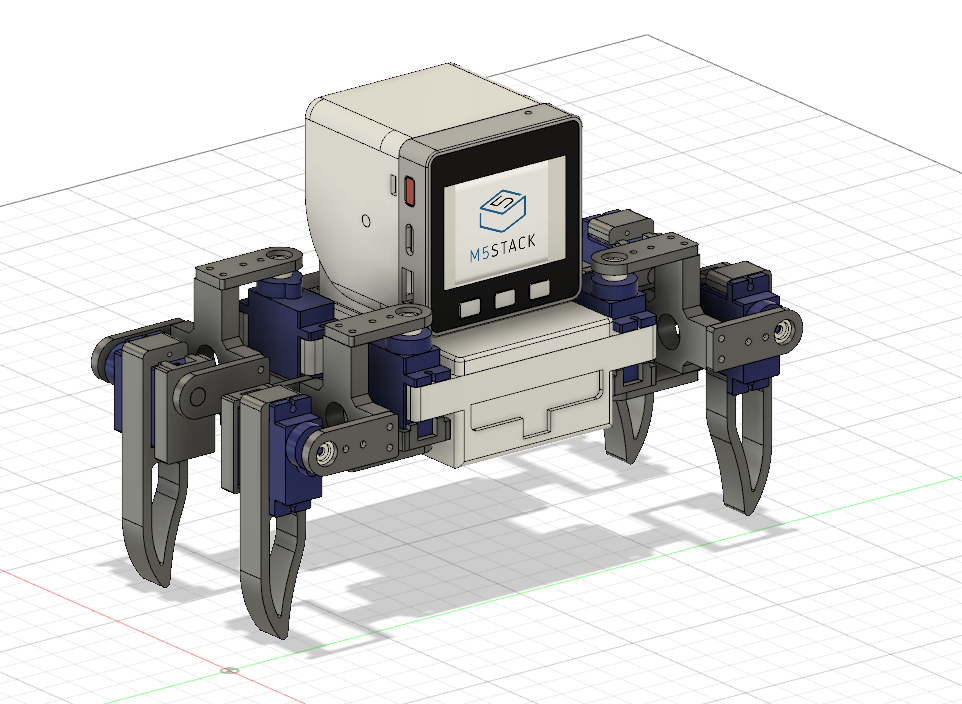
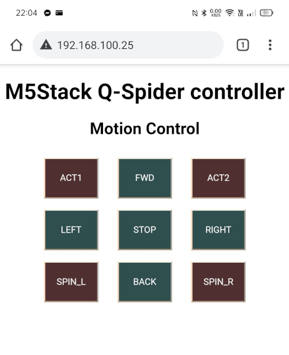
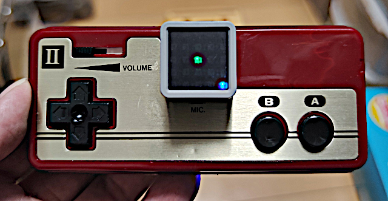

# M5Stack_QSpider

## Quadruped Spider Robot for M5Stack
It is a quadruped walking robot using M5Stack and nine toy servos (SG90). It utilizes a custom servo module board for M5Stack equipped with PCA9685.

M5Stackとトイサーボ(SG90)x9個を使用した四脚歩行ロボットです。PCA9685を搭載したM5Stack用の自作サーボモジュール基板を使用しています。

Botttom View

### 3D Print Data

The 3D print data is available below. Please print four sets of parts from the 'leg' folder, as each set corresponds to one leg.

3Dプリント用のデータは以下にあります。legフォルダ以下の部品は1本分なので4個印刷してください。

[3D Print Data](3dprint/leg/)

The fully assembled main body and each leg (two types, diagonal combinations) is uploaded in STEP format. Please refer to them during assembly.

組立済の本体全体・各脚(対角の組合せで2種類)はSTEP形式でアップロードしてありますので、参考にしてください。

[STEP Data](3dprint/)

### M5Stack Servo Driver Module
### M5Stack用サーボモジュール基板
The circuit diagram, Gerber data, and KiCad design files have been published in this repository under the `pcb/` folder.

回路図、ガーバーデータ、KiCadの設計データは本リポジトリの `pcb/` フォルダ以下で公開しています。

[PCB Design Data](pcb/M5_PCA9685_v03/)

Production outputs (Gerber, BOM, pick-and-place) are available in `pcb/production/`.

[Production Data](pcb/production/)

生産用データ（ガーバーやBOM、実装座標）も `pcb/production/` に用意しています。

[生産用データ](pcb/production/)

### Parts needed (excluding 3D print parts)
* M5Stack Basic x 1
* [SG-90](https://akizukidenshi.com/catalog/g/gM-08761/) X 9
* [M5Stack Servo Driver Module](pcb/M5_PCA9685_v03/) (PCA9685 based servo controller board) x 1
  * Please refer to `pcb/production` for implementation data.
* [Battery Holder for 4x AA](https://akizukidenshi.com/catalog/g/gP-03087/) (For servo power)
* [Pololu S9V11F5](https://www.pololu.com/product/2865) (Step-up/step-down voltage regulator, generates 5V for M5Stack from AA battery)
  * [Switch-Sciense S9V11F5](https://www.switch-science.com/products/3246)
* M2x8mm Tapping Screws (Approximately 40)
* [Wiring Lead, Red/Black](https://akizukidenshi.com/catalog/g/g131311/)
* [Connector Housing 2P](https://akizukidenshi.com/catalog/g/g112151/)
* [Double-sided Adhesive Gel Tape](https://jp.daisonet.com/products/4550480578279) (For fixing servo bottom_Spacer)

### 必要な部品 (3Dプリント部品以外)
* M5Stack Basic x 1
* [SG-90](https://akizukidenshi.com/catalog/g/gM-08761/) X 9
* [M5Stack用サーボモジュール基板](pcb/M5_PCA9685_v03/) (PCA9685搭載サーボコントローラ基板) x 1
  * 実装は `pcb/production` の内容を参考にしてください
* [電池ボックス単4×4本](https://akizukidenshi.com/catalog/g/gP-03087/) (サーボ電源用)
* [Pololu S9V11F5](https://www.pololu.com/product/2865) (昇降圧型電圧レギュレータ、単4電池からM5Stack用5Vを生成)
  * [Switch-Sciense S9V11F5](https://www.switch-science.com/products/3246)
* M2x8mmのタッピングビス(約40本)
* [配線用リード線 赤・黒](https://akizukidenshi.com/catalog/g/g131311/)
* [コネクター用ハウジング 2P](https://akizukidenshi.com/catalog/g/g112151/)
* [両面粘着ゲルテープ](https://jp.daisonet.com/products/4550480578279) (サーボ bottom_Spacer 固定用)

## ソフトウエア: Software
There are sketches for ArduinoIDE in the 'examples' folder. There are two types available for web interface and ESP-NOW.

ArduinoIDE用のスケッチがexample以下にあります。Webインターフェース用とESP-NOW用の2種類があります。

### Controler with Web Interface Webインターフェース
It starts as a WiFi access point and can be controlled from a web browser.

WiFiのアクセスポイントとして起動し、Webブラウザからコントロールできます。

### Controller for ESP-NOW mode ESP-NOW用コントローラ
The source code for the ESP-NOW controller is available below. Here, a modified Famicom controller is used.

ESP-NOW用コントローラのソースコードは以下にあります。ここではファミコン用コントローラを改造して使用しています。

<https://github.com/tomorrow56/nespad-arduino>

### Protopedia
<https://protopedia.net/prototype/2464>
